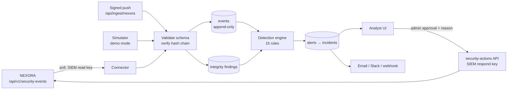
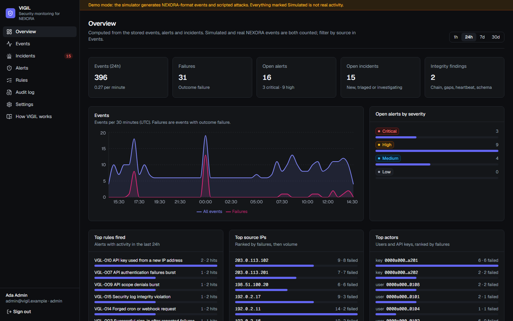
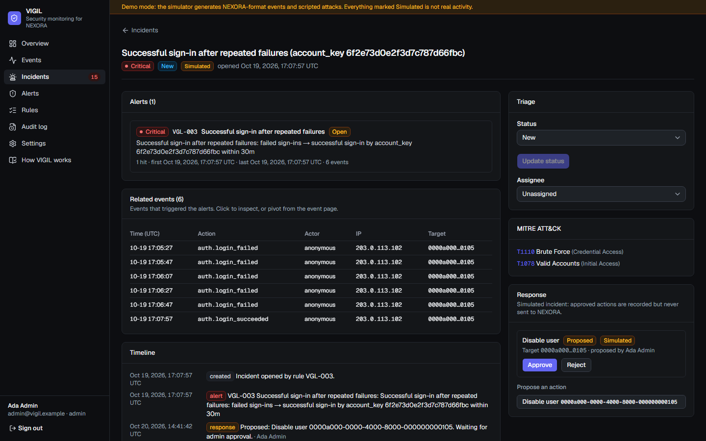
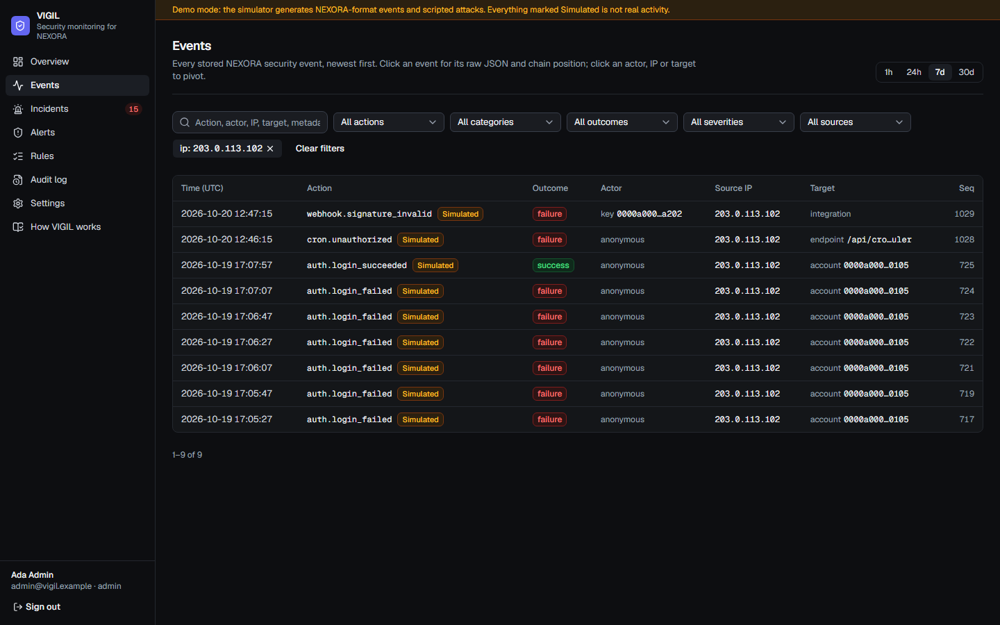
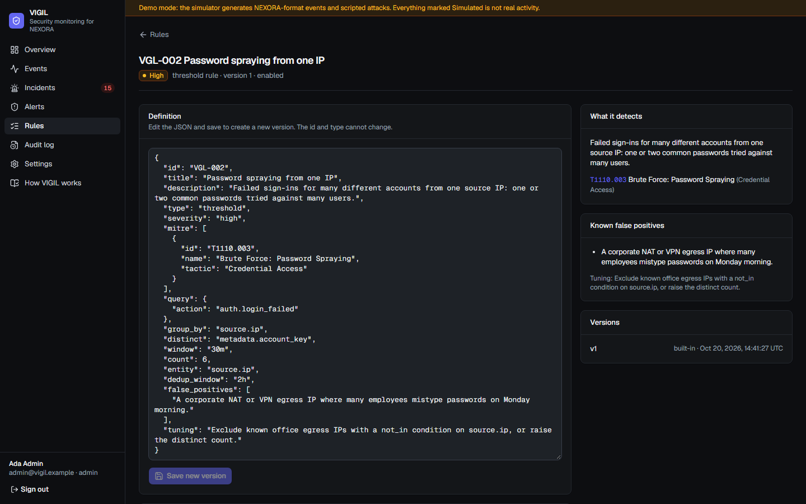

# VIGIL

**Security monitoring for NEXORA.** VIGIL ingests the security log of the [NEXORA](https://github.com/softlys/nexora) B2B platform, verifies its hash chain, detects attacks with versioned rules, groups alerts into incidents, and lets an admin respond (revoke an API key, disable a user) through NEXORA's security API. Nothing destructive happens without a human approving it.

> **What VIGIL is not.** VIGIL is a demonstration SIEM built for one product. It is not a replacement for Splunk, Elastic Security or Microsoft Sentinel:
> - there is no general log ingestion, no query language, no correlation across products and no threat-intelligence feeds
> - it has not been scale-tested
>
> [docs/limitations.md](docs/limitations.md) lists what it covers and what it does not.

## What it does

- **Ingestion.** A worker polls `GET /api/v1/security-events` with a read-only SIEM key. Its cursor is durable, it backs off on errors, and it reports connector health. An optional HMAC-signed push receiver is available. Every event is validated against a copy of NEXORA's Zod schema, and a mismatch stops the connector instead of dropping data. Events are stored raw and normalized in an append-only table.
- **Integrity.** On ingest, VIGIL recomputes each `hash = SHA-256(prev_hash + canonical JSON)`, checks the `prev_hash` link and sequence continuity, and expects a heartbeat at least every 15 minutes. A modified event, a missing sequence number, a re-linked chain or a silent scheduler each becomes a critical alert.
- **Detection.** Fifteen built-in rules are stored as versioned JSON (inspired by Sigma). Rule types are single event, threshold, sequence, new value and integrity. They cover brute force, password spraying, success after failures, IDOR probing, privilege escalation, API key abuse, bulk-read exfiltration, automation tampering, SSRF, forged cron and webhook calls, and log tampering. Each rule maps to MITRE ATT&CK techniques that were checked on attack.mitre.org. Rules can be backtested over stored history.
- **Investigation.** The overview is computed from stored data. The event explorer has time ranges, filters and free-text search, and from any event you can open its raw JSON, see its chain position, or pivot by actor, IP or target. Alerts are deduplicated and grouped into incidents, which move through new → triaged → investigating → resolved / false positive, with assignee, notes, timeline and ATT&CK mapping.
- **Response.** Playbooks revoke an API key or disable a user. Anyone can propose one; only an admin can approve, always with a written reason. Approved actions run through NEXORA's `security-actions` API using a separate respond key, and the request and response summary is recorded in the incident timeline and audit log.
- **Notifications.** Email (Resend), Slack or a signed webhook for high-severity alerts. Each channel is active only when configured.
- **Demo mode.** VIGIL starts with no NEXORA and no credentials. A simulator writes realistic NEXORA activity and scripted attacks in the exact NEXORA schema, with a valid hash chain. Everything it produces is labelled **Simulated**.

## Architecture



More detail is in [docs/architecture.md](docs/architecture.md).

## Screenshots

| Overview | Incident |
| --- | --- |
|  |  |
| **Event explorer** | **Rule editor and backtest** |
|  |  |

These are real screenshots of demo mode. All of the data shown is simulated.

## Quick start (demo mode)

```bash
npm install
npm run dev
```

Open http://localhost:3000 and sign in with a demo account. The login page shows them; they exist only in demo mode.
- `admin@vigil.example` (admin)
- `analyst@vigil.example` (analyst)
- password `vigil-demo-2026`

On first start, VIGIL backfills three days of simulated activity that includes every attack scenario, so alerts and incidents are ready to investigate. To run a scenario on demand, go to **Settings → Simulator**.

Demo mode uses an embedded PostgreSQL (PGlite) stored in `.data/pglite`, and the web server runs the worker. To reset it, stop the server and run `npm run demo:reset`.

## Connecting to NEXORA

1. In NEXORA, go to **Settings → API keys** and create two **SIEM** keys:
   - one with `security:read`, for polling
   - one with `security:respond`, for approved responses
2. Set the following in `.env.local`:

   ```bash
   NEXORA_URL=http://localhost:3000
   NEXORA_SECURITY_API_KEY=nxk_siem_…   # security:read
   NEXORA_RESPONSE_API_KEY=nxk_siem_…   # security:respond
   VIGIL_SIMULATOR=0                    # optional: only real events
   ```

3. Start VIGIL on another port (`npm run dev -- -p 3300`). **Settings → NEXORA connector** shows the connection state, and **Test connection and poll now** polls at once.
4. Optionally, reproduce attacks against **your own** NEXORA with the drill: `DRILL_TARGET_URL=http://localhost:3000 DRILL_API_KEY=nxk_int_… npm run drill -- --yes`. See [docs/drill.md](docs/drill.md).

NEXORA must have `CRON_SECRET` set, with its cron calling the scheduler. Without heartbeats, VIGIL raises a heartbeat-gap integrity alert, as it should.

## Scripts

| Command | What it does |
| --- | --- |
| `npm run dev` / `npm run build` / `npm start` | Web app (and, with the embedded database, the worker) |
| `npm run worker` | Ingestion and detection worker as its own process (PostgreSQL deployments) |
| `npm run db:migrate` | Apply migrations and first-start setup |
| `npm run demo:reset` | Delete the embedded demo database |
| `npm run drill -- --yes` | Live drill against a NEXORA instance you own |
| `npm run lint` / `npm run typecheck` | ESLint / route types and `tsc --noEmit` |
| `npm test` | Vitest: rule types, every built-in rule, chain verification, dedup, connector, response, notifications, scenarios end to end |
| `npm run test:e2e` | Playwright against a production build in demo mode |

## Documentation

| Document | Contents |
| --- | --- |
| [architecture.md](docs/architecture.md) | Components, data flow, storage, worker, security of VIGIL itself |
| [event-schema.md](docs/event-schema.md) | The NEXORA event contract, hash chain, normalization |
| [detection-rules.md](docs/detection-rules.md) | Rule format and every built-in rule: logic, ATT&CK ids, tuning, known false positives |
| [response.md](docs/response.md) | Playbooks, approval flow, what gets logged |
| [drill.md](docs/drill.md) | Live drill against NEXORA, safety rules |
| [deployment.md](docs/deployment.md) | PostgreSQL, worker, environment, MFA/SSO, headers |
| [limitations.md](docs/limitations.md) | Detection coverage and limits, honest gaps |
| [PROGRESS.md](PROGRESS.md) | Build log, verification, known issues, decisions |

## Tech stack

Next.js 16 (App Router) · React 19 · TypeScript (strict) · Tailwind CSS 4 · shadcn/ui · Lucide · Recharts · Zod · PostgreSQL (node-postgres) or embedded PGlite · Vitest · Playwright

## License

[MIT](LICENSE)
